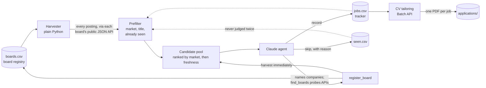

# AI Job Agent

A scheduled job-search agent that reads company job boards directly, has Claude judge
each opening against a written set of criteria, keeps a deduplicated tracker that grows a
little every run, and writes a tailored, one-page CV for every job it records, plus a
cover letter unless the posting asks you not to send one.

It runs every morning on GitHub Actions, recording a handful of jobs a day with the freshest
postings first, and needs no machine left on. See [What it costs](#what-it-costs).

## Why it's built this way

The first version was a single LLM agent with web search and a page fetcher. It worked,
but it had three problems:

- **It found jobs by accident.** Search engines index a handful of each company's postings.
  Careers pages are mostly JavaScript, so a plain fetch often returned an empty page and the
  agent fell back to search.
- **It spent tokens on discovery, not judgement.** Most of the budget went on finding
  listings and confirming they were still open.
- **It forgot everything.** A role rejected on Monday was found, read and rejected again on
  Wednesday.

So the work is now split by what each part is good at:



- **The harvester is deterministic code.** Greenhouse, Lever, Ashby, SmartRecruiters,
  Workable, Recruitee and Workday all expose public JSON for their job boards. Reading
  those returns every open role at a company in one request, with first-party dates,
  locations, salaries and descriptions. No scraping, no rendering, no model calls.
- **Singapore's national job portal covers the long tail.** Employers must advertise on
  MyCareersFuture for 14 days before applying for an Employment Pass, so a keyword search
  there reaches employers nobody would think to look for, early in each posting's life,
  with a running count of applicants. Its employers also feed board discovery. Applying
  through MyCareersFuture itself is open to Singapore citizens and PRs only, so its links are
  never recorded: the agent finds the same role on the employer's own page and records that
  instead (`add_jobs` refuses a MyCareersFuture link), or skips it when there is no route
  to apply.
- **A cheap prefilter removes the obvious.** Postings outside the target countries,
  non-engineering titles, and anything already tracked or judged never reach the model.
  It is deliberately loose: when unsure, it keeps the posting.
- **The model only judges.** It reads a compact summary of each candidate, including the
  sentences that state experience or PhD requirements, and opens the full posting only
  when the summary doesn't settle it. Every decision is written down, so nothing is judged
  twice.
- **The registry learns.** The model's remaining budget goes on discovery. It names
  employers in each market, and `find_boards` checks each name against six job-board
  systems' APIs by trying likely slugs (web `site:` searches mostly return aggregators, so
  they're a fallback). A confirmed board is registered and harvested on the spot and on every
  later run, so one discovered company is worth every role it ever posts. Discovery doesn't
  use up the run's job slots, so it continues after they're full.
- **No single source dominates.** Singapore comes first, then India and Canada as equals.
  Each has a share of the run's slots (by default Singapore 60%, India and Canada 20% each:
  3, 1 and 1 of 5). A market that hasn't filled its share after 15 of its candidates have
  been judged (or that runs out) gives its slots to the others, Singapore first; the US is
  capped. The rest wait in the pool.
- **Many employers, few crowds.** A company is recorded at most once per run, and a company
  that had a job recorded in the last 14 days is held back (its roles come back later).
  Postings from large employers (150+ open roles on their own board) or with 100+
  applicants are marked crowded, ranked after the rest, and capped at two per run.
  Discovery is aimed at employers most applicants never think of: scale-ups, SMEs,
  regional hubs, research institutes and industrial firms hiring for AI.
  A job listed both on a company's board and on MyCareersFuture is judged once.
- **Roles on unsupported systems still count.** For employers on Darwinbox, Keka, iCIMS
  and the like, the agent falls back to search and fetch, with explicit verification
  rules (employer page over aggregator, never construct a URL).
- **Every recorded job gets a CV, and the CV can't invent anything.** After each search, a
  second job tailors a CV per new job: a model selects and rewords bullets from your CV
  source, a second model reviews it as the hiring manager would, and deterministic checks
  reject any number, skill or role the source doesn't contain. A cover letter is written
  the same way, on the finished CV, unless the posting declines one. See
  [Tailored CVs](#tailored-cvs).

## Project layout

```
jobagent/
  ats/            one adapter per job-board system (and MyCareersFuture): parsing, fetching
  harvest.py      reads all boards concurrently, prefilters, ranks; runnable on its own
  filters.py      market classification, title filter, experience/PhD/staleness hints
  registry.py     boards.csv: every board found, with health and yield stats
  discover.py     finds a company's board from its name by probing each system's API
  store.py        jobs.csv and seen.csv, with URL normalisation for deduplication
  agent.py        the Claude Agent SDK run and the seven tools it gets
  prompt.py       the run instructions (profile-specific text comes from your files)
  seed.py         add boards by hand, or from an existing tracker
  postings.py     saved posting text, and re-reading a posting from its job board
  cv/             tailored CVs: model requests, batch runs, content rules, LaTeX template, PDF checks
tests/            adapters, filters, dedup, the agent's tools, and CV tailoring (no network or API needed)
example/profile/  sample resume, criteria and CV source
```

## Setup

Personal files live in a **separate private repository**, so this one can be public.

1. **Create the private data repo** (for example `job-agent-data`) with this layout:

   ```
   profile/resume.md      your resume, as plain text or markdown
   profile/criteria.md    what you want, and the skip list (see example/profile)
   profile/fit_keywords.txt  optional: weighted keywords that put the best-fitting jobs first
   profile/cv_source.yaml    your CV as structured data, the only source tailored CVs use
                             (see example/profile/cv_source.yaml)
   data/                  created on the first run
   ```

2. **Create a fine-grained access token** at GitHub → Settings → Developer settings →
   Fine-grained tokens. Give it access to the data repo only, with
   *Contents: Read and write*.

3. **In this repo's settings** (Settings → Secrets and variables → Actions):
   - Secret `ANTHROPIC_API_KEY`: your key from console.anthropic.com
   - Secret `DATA_REPO_TOKEN`: the token from step 2
   - Variable `DATA_REPO`: `your-username/job-agent-data`
   - Optional variables `MAX_BUDGET_USD` (default 2.00), `MAX_NEW_JOBS` (default 6),
     `MAX_US_JOBS` (default 1), `MAX_PER_COMPANY` (default 1), `COMPANY_COOLDOWN_DAYS`
     (default 14), `LARGE_EMPLOYER_POSTINGS` (default 150), `CROWDED_APPLICANTS` (default
     100), `MAX_CROWDED_PER_RUN` (default 2), `COVER_LETTERS` (default `when_required`;
     or `when_asked`, `unless_declined`), `MARKET_SHARES` (default
     `Singapore=0.6,India=0.2,Canada=0.2`), `MARKET_RELEASE_AFTER` (default 15: candidates
     judged in a market before its unfilled share goes to the others), `JOBAGENT_MODEL` (default `sonnet`; set to
     `opus` for the larger model)
     and `MAX_TAILOR` (default 40: CVs tailored per scheduled run)

4. **Check the boards first.** Actions → Job search run → Run workflow → *harvest-only*.
   This reads every board and prints the pool without calling the model.

5. **Check your CV renders**, locally: `python -m jobagent.cv baseline --out out/` (see
   [Running locally](#running-locally)). It builds your full CV from `cv_source.yaml` with
   no model calls, so layout problems show up before any money is spent.

6. **Run it for real** with *full*, or wait for the schedule. Results are committed to
   the data repo. Each run's summary appears on the Actions run page and in
   `data/runs.csv`; the CV tailoring job after it adds its own summary.

7. **Optional: catch up on older jobs.** Actions → Tailor CVs → Run workflow with the URL
   box empty tailors every tracked job that has no CV yet, at batch prices.

### Running locally

```bash
pip install -r requirements.txt
git clone https://github.com/your-username/job-agent-data private
python -m jobagent.harvest                         # check every registered board
python -m jobagent.harvest https://jobs.lever.co/x # check one board
python -m jobagent.seed URL --company "Name"       # add a board by hand
python -m jobagent.discover "Sarvam AI" "Qure.ai"  # look for companies' boards
ANTHROPIC_API_KEY=... python -m jobagent.agent     # full run
python -m jobagent.cv baseline --out out/          # your full CV, no model calls
ANTHROPIC_API_KEY=... python -m jobagent.cv tailor URL  # one tailored CV, standard prices
python -m pytest -q
```

CVs need `pdflatex`: on Ubuntu, `texlive-latex-base texlive-latex-recommended
texlive-latex-extra texlive-fonts-recommended`; on Windows, MiKTeX with "install missing
packages on-the-fly" turned on. On Windows PowerShell, set variables with
`$env:JOBAGENT_HOME = "private"` instead of the `NAME=value` prefix.

## Tailored CVs

Three ways to get one:

- **Automatically:** after every scheduled search, for the jobs it just recorded (and any
  older ones still without a CV, newest first, up to `MAX_TAILOR`).
- **The backlog:** Actions → Tailor CVs → Run workflow with the URL box empty.
- **Specific jobs now:** the same workflow with posting URLs pasted in (separated by
  spaces), or locally:

```bash
python -m jobagent.cv tailor URL [URL ...]           # needs ANTHROPIC_API_KEY
python -m jobagent.cv tailor URL --posting-file F     # when the job board can't be read
python -m jobagent.cv tailor URL --letter             # a cover letter even if not asked for
```

For each posting there are five steps, each a single API request:

1. **Research** what the company does (Sonnet with up to 3 web searches). Notes are cached
   per company in `data/companies/` for 45 days, so the fourth Cohere role costs nothing here.
2. **Draft** a tailored selection of your CV source (Opus). The draft also records what
   the posting says about a cover letter (see [Cover letters](#cover-letters)).
3. **Critique** it as the hiring manager would (Sonnet): claims the source doesn't support,
   requirements the source covers but the draft leaves out, emphasis.
4. **Revise** with that review (Opus), skipped when the review says it's ready.
5. **Check and render**: the content checks below, with up to two repair requests if they
   fail, then the PDF build and its checks.

**Automatically, after every scheduled search**, a second job tailors CVs for tracked jobs
that don't have one yet (status `new`, not applied to), newest first, up to `MAX_TAILOR`
per run. It sends the same requests through the Batch API at half price, about $0.07–0.10
per CV. Just before tailoring, each posting is re-read from its job board, and one that
has closed is skipped. A batch still running when the job's time runs out is collected by
the next run.

The tracker's `cv` column then holds the PDF's path, `failed: <reason>` (details in that
job's `review.json`), or `skipped: posting closed`. Clear the cell to have it tried again.

### Cover letters

The CV's draft step records, from the posting text alone, what it says about a letter:
**required**, **invited** (optional, asks why you want the role, or apply by email to a
named person), **not mentioned**, or **declined** (asks you not to send one). By default
(`COVER_LETTERS=when_required`) only a job whose posting requires a letter gets one, to
keep costs down. With `COVER_LETTERS=when_asked`, invited ones get one too; with
`COVER_LETTERS=unless_declined`, every job does unless the posting declines one (forms
often have a cover letter box the posting never mentions). Set it as a repository
variable to change it. The decision costs no extra request.

The letter is written after the CV is final, so the two agree, in the same steps: a draft
(Opus) from your CV source, the finished CV, the posting and the company notes; a
hiring-manager review (Sonnet); a revision unless the review passes it; then checks, with
up to two repairs. The checks reject a number that appears in none of your source, the
posting or the company notes, a placeholder like `[Company]`, fewer than three or more than
five paragraphs, or more than 380 words, and flag stock phrases. Your name, contact
details, the date, the company and role, and the signature come from the source and the
posting, never from the model.

A letter that fails never holds back the CV. The tracker's `cover_letter` column holds the
letter's path, `not wanted: <reason>` (the posting declined one), `not needed: <reason>`
(the posting doesn't require one), or `failed: <reason>`. To force a letter anyway, run the Tailor CVs
workflow with the job's URL and **letter** ticked (or `tailor URL --letter`). At batch
prices a letter costs about $0.05–0.08.

The posting text comes from `data/postings/`, which `add_jobs` fills as jobs are recorded:
the job board's own text, or, for a job the agent found by open search, the text it read on
the page (`posting_text`). A job with neither is read again at tailoring time: from its job
board, or else from the page itself (its schema.org JobPosting data, which most careers
sites and LinkedIn carry, or failing that its visible text). Older tracker rows can be
re-read by hand with `python -m jobagent.postings URL`.
Output goes to `data/applications/<company>_<role>_<id>/`: the PDF (named after you, e.g.
`Jane_Example_CV.pdf`, since that is what recruiters see), `tailored.json`, and
`review.json` with every step, the review, any gaps the posting asks for that your CV can't
support, and the token usage. With a letter, the same folder holds
`Jane_Example_Cover_Letter.pdf`, `cover_letter.tex` and `cover_letter.json`, and
`review.json` records its decision, drafts, review and checks. The tracker's `cv` and
`cover_letter` columns point to the PDFs.

A tailored CV is a **selection and rewording** of `profile/cv_source.yaml`, never free
text. A model returns which bullets to use, in what order and how to word them; the
fixed LaTeX template in `jobagent/cv/` supplies the layout, and titles, employers,
dates and contact details are always copied from the source file. That keeps every CV
in the same format and makes the checks deterministic:

- **Content, before rendering:** every bullet names the source bullet it came from and
  may only use numbers from that bullet (or its entry's header); skills and coursework
  must exist in the source; every role must appear; summary and bullets have word limits.
- **The PDF, after rendering:** it compiles; it fits `layout.max_pages`; the last page
  isn't a near-empty spill-over; name, email, phone and every bullet are readable in the
  text layer, which is what applicant-tracking systems parse.
- **Layout choices:** the model may put Projects before Experience for research-heavy
  roles (jobs always stay in date order), and may pick a headline from your
  `headline_options`; anything else is rejected.
- **Fitting:** a CV over its page limit loses its least important bullet (the model lists
  them most-relevant first) until it fits, and every removal is reported.

All model text is LaTeX-escaped, so nothing in a posting or a model reply can act as a
LaTeX command.

```bash
python -m jobagent.cv baseline --out out/          # your full CV, every bullet
python -m jobagent.cv check tailored.json --out out/
```

Needs `pdflatex` with `texlive-latex-extra` and `texlive-fonts-recommended`.

## Archiving what you've applied to

When you apply, put `yes` (or `y`, `x`, `done`) in that job's `applied` column and push.
The next search run, before it searches, moves the job out of `jobs.csv`:

- the row goes to `data/archive/applied.csv`, with the date it was archived and its folder;
- the application folder (CV, cover letter, `review.json`) moves to
  `data/archive/<company>_<role>_<id>/`, with the `cv` and `cover_letter` paths updated;
- the posting text is copied into that folder as `posting.md`, because postings usually
  disappear once a job closes, and it's what to reread before an interview.

Not applying? Put `no` (or `n`, `skip`, `pass`) in the `applied` column instead. The next
run moves the row to `data/archive/not_applied.csv` and deletes its CV, cover letter and
saved posting.

An archived job, either way, stays in `seen.csv`, so it is never recorded again, and its
company and role count in the duplicate check, so a repost under a new URL isn't either.
CV tailoring stops work on a job as soon as it is marked `yes` or `no` (or leaves the
tracker), even mid-batch, and cancels a running batch that holds nothing else, so you can
apply without waiting for the CV and nothing more is spent on it. To archive straight
away without a search: `python -m jobagent.archive`.

## The data files

| File | What it holds |
| --- | --- |
| `jobs.csv` | The tracker. `status` and `applied` are yours to edit. The agent only appends rows; CV tailoring fills in each row's `cv` and `cover_letter` columns. A job is tailored while its `status` is `new` and `applied` is blank. |
| `seen.csv` | Every posting judged, with the decision and the reason. Delete a row to have it judged again. |
| `boards.csv` | The registry. Set `enabled` to `no` to stop reading a board. A board that fails three runs in a row disables itself. |
| `runs.csv` | One line per run: boards read, pool size, recorded, skipped, cost. |
| `postings/` | The text of each recorded posting, saved when it was recorded. |
| `applications/` | Tailored CVs and cover letters, one folder per posting. |
| `archive/` | Jobs marked applied: `applied.csv` and one folder each with the CV, letter and posting. Jobs marked `no`: `not_applied.csv` (rows only). |
| `companies/` | Company research notes used by the CV reviewer, reused for 45 days. |
| `tailor_state.json` | CV tailoring in progress between runs (normally empty). |

## What it costs

GitHub Actions is free here, because the workflows run in this public repository. The
Anthropic API is the only cost:

| | Per run | Per week (7 runs) |
| --- | --- | --- |
| Job search | up to `MAX_BUDGET_USD` ($2 by default) | up to $14 |
| CV tailoring, Batch API | about $0.07–0.10 per CV, one per job recorded (6 by default) | about $3–4 |
| Cover letters, Batch API | about $0.05–0.08 each, for every job unless the posting declines one | about $2–4 |

The pools are judged before discovery, so a tight budget trims discovery (finding new
boards) first.

Tailoring a job by hand (the Tailor CVs workflow with URLs, or `tailor` locally) skips the
batch discount: about $0.15 per CV. The `cost_usd` column of `data/runs.csv` has each
search run's real cost, and each CV's `review.json` has its own.

## Adding a job-board system

Write a module in `jobagent/ats/` with `NAME`, `parse_url`, `parse` and `fetch` (plus
`detail` if descriptions need a second request), add it to `ADAPTERS`, and add a fixture
test. `parse` takes the raw payload and is pure, so it can be tested without a network.

## Limitations

- Adapter parsers are written against each system's documented response shape and tested
  on fixtures. A system can change its payload; a board that starts failing shows up in
  the run summary and in `boards.csv`.
- Workday tenants are searched by keyword (see `WORKDAY_SEARCH_TERMS` in `config.py`)
  rather than read in full, because large employers list thousands of roles.
- The model's judgement is only as good as the criteria file. The skip list is the whole
  filter by design: recording a maybe costs one line to dismiss, a skipped match is
  invisible.
- A tailored CV's automatic checks catch invented numbers, skills and roles, not every
  overstated claim: "led" where the source says "supported" has no number to check. The
  reviewer step is there for those, and caught every one in the test runs, but read a CV
  before you send it. The same goes for cover letters, whose claims about the company are
  checked only by the reviewer.
