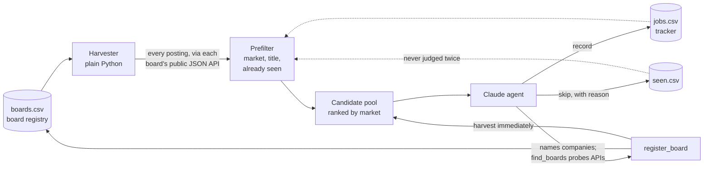

# job-agent

A scheduled job-search agent that reads company job boards directly, has Claude judge
each opening against a written set of criteria, and keeps a deduplicated tracker that
grows a little every run.

It runs three times a week on GitHub Actions, costs a few dollars a run, and needs no
machine left on.

## Why it's built this way

The first version was a single LLM agent with web search and a page fetcher. It worked,
but it had three problems:

- **It found jobs by accident.** Search engines index a handful of each company's postings.
  Careers pages are mostly JavaScript, so a plain fetch often returned an empty page and the
  agent fell back to search.
- **It spent tokens on discovery, not judgement.** Most of the budget went on finding
  listings and confirming they were still open.
- **It forgot everything.** A role rejected on Monday was found, read and rejected again on
  Wednesday.

So the work is now split by what each part is good at:



- **The harvester is deterministic code.** Greenhouse, Lever, Ashby, SmartRecruiters,
  Workable, Recruitee and Workday all expose public JSON for their job boards. Reading
  those returns every open role at a company in one request, with first-party dates,
  locations, salaries and descriptions. No scraping, no rendering, no model calls.
- **Singapore's national job portal covers the long tail.** Employers must advertise on
  MyCareersFuture for 14 days before applying for an Employment Pass, so a keyword search
  there reaches employers nobody would think to look for, early in each posting's life,
  with a running count of applicants. Its employers also feed board discovery.
- **A cheap prefilter removes the obvious.** Postings outside the target countries,
  non-engineering titles, and anything already tracked or judged never reach the model.
  It is deliberately loose: when unsure, it keeps the posting.
- **The model only judges.** It reads a compact summary of each candidate, including the
  sentences that state experience or PhD requirements, and opens the full posting only
  when the summary doesn't settle it. Every decision is written down, so nothing is judged
  twice.
- **The registry learns.** The model's remaining budget goes on discovery. It names
  employers in each market, and `find_boards` checks each name against six job-board
  systems' APIs by trying likely slugs (web `site:` searches mostly return aggregators, so
  they're a fallback). A confirmed board is registered and harvested on the spot and on every
  later run, so one discovered company is worth every role it ever posts. Discovery doesn't
  use up the run's job slots, so it continues after they're full.
- **No single source dominates.** India and Singapore are worked as equals, each limited
  to a share of the run while the other has candidates waiting; Canada follows, the US is
  capped, and no company can take more than three slots in a run. The rest wait in the pool.
  A job listed both on a company's board and on MyCareersFuture is judged once.
- **Roles on unsupported systems still count.** For employers on Darwinbox, Keka, iCIMS
  and the like, the agent falls back to search and fetch, with explicit verification
  rules (employer page over aggregator, never construct a URL).

## Project layout

```
jobagent/
  ats/            one adapter per job-board system (and MyCareersFuture): parsing, fetching
  harvest.py      reads all boards concurrently, prefilters, ranks; runnable on its own
  filters.py      market classification, title filter, experience/PhD/staleness hints
  registry.py     boards.csv: every board found, with health and yield stats
  discover.py     finds a company's board from its name by probing each system's API
  store.py        jobs.csv and seen.csv, with URL normalisation for deduplication
  agent.py        the Claude Agent SDK run and the six tools it gets
  prompt.py       the run instructions (profile-specific text comes from your files)
  seed.py         add boards by hand, or from an existing tracker
  postings.py     saved posting text, and re-reading a posting from its job board
  cv/             tailored CVs: model requests, content rules, LaTeX template, PDF checks
tests/            adapter parsing, URL detection, filters, dedup, and the agent's tools
example/profile/  sample resume and criteria
```

## Setup

Personal files live in a **separate private repository**, so this one can be public.

1. **Create the private data repo** (for example `job-agent-data`) with this layout:

   ```
   profile/resume.md      your resume, as plain text or markdown
   profile/criteria.md    what you want, and the skip list (see example/profile)
   profile/fit_keywords.txt  optional: weighted keywords that put the best-fitting jobs first
   data/                  created on the first run
   ```

2. **Create a fine-grained access token** at GitHub → Settings → Developer settings →
   Fine-grained tokens. Give it access to the data repo only, with
   *Contents: Read and write*.

3. **In this repo's settings** (Settings → Secrets and variables → Actions):
   - Secret `ANTHROPIC_API_KEY`: your key from console.anthropic.com
   - Secret `DATA_REPO_TOKEN`: the token from step 2
   - Variable `DATA_REPO`: `your-username/job-agent-data`
   - Optional variables `MAX_BUDGET_USD` (default 5.00), `MAX_NEW_JOBS` (default 25),
     `MAX_US_JOBS` (default 5), `MAX_PER_COMPANY` (default 3), `TOP_MARKET_SHARE`
     (default 0.4) and `JOBAGENT_MODEL` (default `sonnet`; set to `opus` for the larger model)

4. **Check the boards first.** Actions → Job search run → Run workflow → *harvest-only*.
   This reads every board and prints the pool without calling the model.

5. **Run it for real** with *full*, or wait for the schedule. Results are committed to
   the data repo. Each run's summary appears on the Actions run page and in
   `data/runs.csv`.

### Running locally

```bash
pip install -r requirements.txt
git clone https://github.com/your-username/job-agent-data private
python -m jobagent.harvest                         # check every registered board
python -m jobagent.harvest https://jobs.lever.co/x # check one board
python -m jobagent.seed URL --company "Name"       # add a board by hand
python -m jobagent.discover "Sarvam AI" "Qure.ai"  # look for companies' boards
ANTHROPIC_API_KEY=... python -m jobagent.agent     # full run
python -m pytest -q
```

## Tailored CVs

```bash
python -m jobagent.cv tailor URL [URL ...]           # needs ANTHROPIC_API_KEY
python -m jobagent.cv tailor URL --posting-file F     # when the job board can't be read
```

For each tracked posting this runs five steps, each a single API request:

1. **Research** what the company does (Sonnet with up to 3 web searches). Notes are cached
   per company in `data/companies/` for 45 days, so the fourth Cohere role costs nothing here.
2. **Draft** a tailored selection of your CV source (Opus).
3. **Critique** it as the hiring manager would (Sonnet): claims the source doesn't support,
   requirements the source covers but the draft leaves out, emphasis.
4. **Revise** with that review (Opus), skipped when the review says it's ready.
5. **Check and render**: the content checks below, with up to two repair requests if they
   fail, then the PDF build and its checks.

The posting text comes from `data/postings/`, which `add_jobs` fills as jobs are recorded;
older tracker rows are re-read from their job board (`python -m jobagent.postings URL`).
Output goes to `data/applications/<company>_<role>_<id>/`: `cv.pdf`, `tailored.json`, and
`review.json` with every step, the review, any gaps the posting asks for that your CV can't
support, and the token usage. The tracker's `cv` column points to the PDF.

A tailored CV is a **selection and rewording** of `profile/cv_source.yaml`, never free
text. A model returns which bullets to use, in what order and how to word them; the
fixed LaTeX template in `jobagent/cv/` supplies the layout, and titles, employers,
dates and contact details are always copied from the source file. That keeps every CV
in the same format and makes the checks deterministic:

- **Content, before rendering:** every bullet names the source bullet it came from and
  may only use numbers from that bullet (or its entry's header); skills and coursework
  must exist in the source; every role must appear; summary and bullets have word limits.
- **The PDF, after rendering:** it compiles; it fits `layout.max_pages`; the last page
  isn't a near-empty spill-over; name, email, phone and every bullet are readable in the
  text layer, which is what applicant-tracking systems parse.
- **Fitting:** a CV over its page limit loses its least important bullet (the model lists
  them most-relevant first) until it fits, and every removal is reported.

All model text is LaTeX-escaped, so nothing in a posting or a model reply can act as a
LaTeX command.

```bash
python -m jobagent.cv baseline --out out/          # your full CV, every bullet
python -m jobagent.cv check tailored.json --out out/
```

Needs `pdflatex` with `texlive-latex-extra` and `texlive-fonts-recommended`.

## The data files

| File | What it holds |
| --- | --- |
| `jobs.csv` | The tracker. `status` and `applied` are yours to edit; the agent only appends. |
| `seen.csv` | Every posting judged, with the decision and the reason. Delete a row to have it judged again. |
| `boards.csv` | The registry. Set `enabled` to `no` to stop reading a board. A board that fails three runs in a row disables itself. |
| `runs.csv` | One line per run: boards read, pool size, recorded, skipped, cost. |
| `postings/` | The text of each recorded posting, saved when it was recorded. |
| `applications/` | Tailored CVs, one folder per posting. |
| `companies/` | Company research notes used by the CV reviewer, reused for 45 days. |

## Adding a job-board system

Write a module in `jobagent/ats/` with `NAME`, `parse_url`, `parse` and `fetch` (plus
`detail` if descriptions need a second request), add it to `ADAPTERS`, and add a fixture
test. `parse` takes the raw payload and is pure, so it can be tested without a network.

## Limitations

- Adapter parsers are written against each system's documented response shape and tested
  on fixtures. A system can change its payload; a board that starts failing shows up in
  the run summary and in `boards.csv`.
- Workday tenants are searched by keyword (see `WORKDAY_SEARCH_TERMS` in `config.py`)
  rather than read in full, because large employers list thousands of roles.
- The model's judgement is only as good as the criteria file. The skip list is the whole
  filter by design: recording a maybe costs one line to dismiss, a skipped match is
  invisible.
